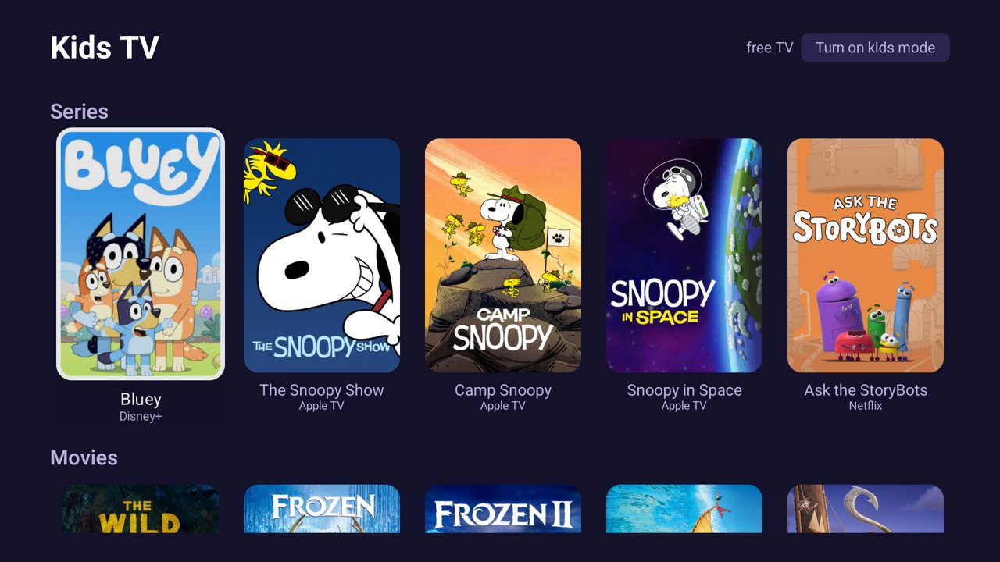

# Kids TV

An app for Google TV / Android TV that becomes the kids' home screen: rows of posters
with only the titles you approved (Disney+, Apple TV, Netflix, Prime Video). Each poster
opens the title straight in the official app. A **watchdog** brings the TV back to this
screen when the kids leave for the app's catalog, open another title or another app, or
press Home.



- **Kids mode:** off by default, so the TV works normally for the adults. Turn it on with
  "Turn on kids mode" before handing the TV over. Leaving it takes a PIN, typed the way
  Google TV asks for its own: ↑ ↓ pick a row of three digits, ← OK → type one of them,
  and only dots show on screen.
- **Rows:** "Continue watching" (the last 6 titles opened on that TV), then the rows from
  `titles.json` (Series, Movies, Documentaries…), then free apps (e.g. Jellyfin).
- The titles in `titles.json` are an **example**: one family's list.

## Install

You need the TV (**Google TV / Android TV**: tested on a TCL with Android TV 14; a Google
TV Streamer or Chromecast with Google TV works too) and, for the install only, a computer
on the same Wi-Fi. Nothing to set up on the computer: the installer downloads Google's
`adb` and the latest release of the app by itself.

1. **On the TV, once:** Settings → System → About → click "Android TV OS build" 7 times
   (developer mode). Then Settings → System → Developer options → **Wireless debugging**
   → On. The TV must be on Wi-Fi (it doesn't work over an Ethernet cable).
2. **Write your list** of titles: copy [`titles.json`](app/src/main/assets/titles.json)
   and edit it (see [Choosing the titles](#choosing-the-titles-titlesjson)). You can skip
   this to try the app with the example list.
3. **Run the installer** on the computer:

   macOS / Linux (Terminal):
   ```sh
   bash <(curl -fsSL https://raw.githubusercontent.com/pedroteixeira/kids-tv-launcher/main/install.sh) --titles titles.json
   ```
   Windows (PowerShell):
   ```powershell
   & ([scriptblock]::Create((irm https://raw.githubusercontent.com/pedroteixeira/kids-tv-launcher/main/install.ps1))) -Titles titles.json
   ```

   It asks for the "IP address & port" shown on the TV's Wireless debugging screen, and
   the first time walks you through pairing ("Pair device with pairing code"). Then you
   choose the **PIN** that leaves kids mode, and it installs the app, sends your list and
   switches the watchdog on.

   The watchdog is an accessibility service, and Android won't let you enable one from
   Settings for an app installed outside the Play Store: that is the step that needs the
   computer. On **TCL** TVs the installer also grants the `AUTO_START` permission;
   without it, TCL's system refuses to run the watchdog.

The app shows up in the TV's app list as **Kids TV**. You can turn Wireless debugging off
afterwards.

**Changing the list or the PIN later:** turn Wireless debugging back on, edit your file and
run the same command with `--titles-only` (`-TitlesOnly` on Windows). The app picks the new
list up on its own. The port changes whenever the TV restarts: read it again on that
screen. A list with a mistake doesn't break the TV: the app shows the error at the top
(outside kids mode) and the example list until you fix it.

**Updating the app:** run the installer again without `--titles-only`.

<details>
<summary>Building from source</summary>

With JDK 17+ and the Android SDK (the easiest way is [Android Studio](https://developer.android.com/studio),
with `JAVA_HOME` pointing at its `<android-studio>/jbr`), from a checkout:

```sh
./install.sh --build --titles titles.json
```

A build from source is signed with your own debug key, so it can't update a TV that has the
released app (or the other way round): the installer offers to uninstall it first, which
also clears the PIN and the "Continue watching" row.

</details>

## Choosing the titles (`app/src/main/assets/titles.json`)

```json
{
  "rows": ["Series", "Movies", "Documentaries"],
  "items": [
    {
      "id": "bluey",
      "title": "Bluey",
      "kind": "series",
      "row": "Series",
      "app": "disney",
      "link": "https://www.disneyplus.com/browse/entity-fa6973b9-e7cf-49fb-81a2-d4908e4bf694",
      "poster": "https://images.justwatch.com/poster/185497966/s718/bluey.jpg",
      "names": ["Bluey"]
    }
  ],
  "free_apps": [{ "title": "Jellyfin", "package": "org.jellyfin.androidtv", "poster": "" }]
}
```

- `app`: `disney`, `apple`, `netflix` or `prime`.
- `link`: the title's address on the service's website (that's what opens in the TV app):
  - **Disney+:** `https://www.disneyplus.com/browse/entity-…`
  - **Apple TV:** `https://tv.apple.com/us/show/<name>/umc.cmc.…` (or `/movie/…`)
  - **Netflix:** `https://www.netflix.com/watch/<id>`. Use `/watch/`, not `/title/`: on
    Netflix the watchdog requires the video to be playing.
  - **Prime Video:** `https://watch.amazon.com/watch?asin=<ASIN>&time=0&territory=US`
- **Finding links:** [JustWatch](https://www.justwatch.com) shows where each title streams.
  Open the title's page on the service's website and copy the address. **Check it on the
  TV**: JustWatch's links are sometimes wrong (Bluey's opened "Bluey Compilations", and
  Frozen 2's and Moana's opened the Sing-Along versions).
- `names`: what the watchdog accepts as "on this title", i.e. the name as it appears on the
  app's page (English, on the US apps). A text matches when it is exactly a name or starts
  with one followed by a comma or colon; never "contains", so "Bluey Compilations" doesn't
  pass as Bluey.
- `free_apps`: apps opened with no watchdog, such as Jellyfin, whose server already limits
  what the kids see.

After editing, send it with the installer's `--titles-only` (see [Install](#install)).

## What the watchdog can see in each app

| App | What it uses |
|---|---|
| Disney+ | The now-playing title and the screen text. Detects the catalog by its menu. |
| Apple TV | The screen text (sometimes). Detects the sidebar. On text-less screens: whether it's playing, and the Back key pressed on the show page. |
| Netflix / Prime | Only whether it's playing, paused or stopped. Leaving the player sends the TV back to the kids' screen. |

**Known limitations:**
- On **Netflix and Prime**, a fast kid can switch titles within a few seconds. Pair this
  with the per-title restrictions of the Netflix kids profile.
- On **Apple TV**, opening a recommendation from inside a show's page isn't detected.
- When the TV **restarts**, the debugging port changes; the installer needs the new one.
- The PIN keeps kids out, not determined adults: anyone with the TV in developer mode and a
  computer can switch the watchdog off.

## Ideas (built in the original project, left out of this version)

- **TV time:** every second, the watchdog already knows which title is in front and
  whether it's playing. In the original project it records one segment per title
  (counting only the seconds that play), keeps it in a file on the TV and sends it to its
  own server, which shows minutes per day and the most-watched titles. A spreadsheet or a
  simple database would work too.
- A **daily time limit** built on that log.
- **One profile per child** when turning kids mode on, each with its own rows.

## Releases (maintainers)

Pushing a tag `vMAJOR.MINOR.PATCH` runs [`release.yml`](.github/workflows/release.yml): it
builds the APK signed with the release key (repository secrets `KIDS_TV_KEYSTORE_BASE64`
and `KIDS_TV_KEYSTORE_PASSWORD`) and publishes it as `kids-tv.apk`, which is what the
installers download. Keep a backup of that key: TVs only accept updates signed with it.

## License

MIT — see [LICENSE](LICENSE).
